# Assimil8or Machines

Replacement firmware for the Rossum Electro-Music Assimil8or. It keeps the
stock sampler and its preset format, and lets any of the 8 channels run a
DSP voice (a "machine") instead of a sample. It also carries the Tallent
Edition's effects and adds a few things of its own.

This is an independent project: not made, endorsed or supported by Rossum.
Use it at your own risk.

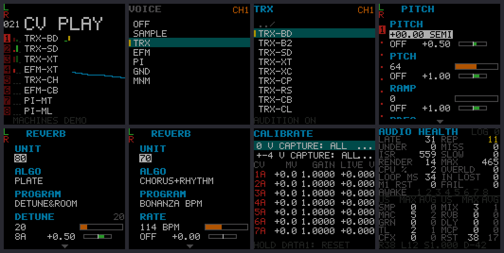

## Install

The firmware is one file, `app`.

1. Copy `app` to the root of the front microSD card.
2. On the module (stock firmware): Utility → Load Software, follow the
   screen, then reboot as it asks.

Your existing presets and folders load unchanged. A8M keeps stock's preset
format, and anything extra it saves is ignored by stock.

### Updating

With this firmware installed, you can update using its own UTILITY →
LOAD SOFTWARE. Put the new `app` on the front card's root, then click
DATA1 to read it (it shows the version found and the one running). Click
again and pick INSTALL. It copies, verifies and restarts by itself. The
previous version is kept on the module's internal card as `app.bak`.

### Going back to stock

The same as updating, with Rossum's `app` on the front card. LOAD SOFTWARE
recognises stock builds and installs them like ours.

## What's new compared with stock

- **Machines on any channel**: per preset, each channel is a sampler or a
  voice, picked by family:
  - TRX, EFM and PI: Machinedrum-style drum voices, from mdkit;
  - GND and MNM: voices from MNMD (GND test tones and noise, SWAVE, SID,
    FM, VO).

  UTILITY → ABOUT shows how many voices this build has.

  Every voice gets pitch, level, pan, bit depth, an envelope and CV routes.
- **Tallent Edition effects** on every channel and the mix: EQ, Filter,
  Comp, Sends, Reverb, Delay, Mix Comp, Grain and Time Lock (Grain and Time
  Lock on sampler channels).
- **Reverb units "70" and "80"**: beside the Tallent reverb (DEP-5), two
  more reverb engines, each with its own algorithms, programs and editable
  parameters, with CV.
- **Calibrate** (UTILITY → CALIBRATE): stock's `cal.bin` as an editable
  table with live readings, so you can trim by hand and hear the edit at
  once. You can measure and calibrate for one input or all. The output
  loopback repeats until it settles; the old file is kept as `cal.bak`.
- **Linked stereo pairs**: a Stereo/Right channel follows its left channel,
  plus offsets of its own settings (edit the right channel to set them).
  This allows for left/right variation for stereo imaging and contrast.
- **START DELAY**: per channel, 0–500 ms before a trigger plays (the first
  field on ENVELOPE, with CV). Useful for flams, offsetting rhythms, and
  Haas-style stereo widening.
- **Audio Health and a health log**: UTILITY → AUDIO HEALTH shows CPU use
  per DSP stage and can log to the front card.
- **Load Software verifies and restarts by itself**: the new `app` is read
  back and checked before it replaces the old one (kept as `app.bak`), then
  the module restarts without a power cycle.
- **Zones CV on the ZONES page**: a live marker shows where the Zones CV
  sits on the zone bar.

## Quality of life

Smaller things that make the module nicer to use day to day:

- **Per-channel loading bars** on HOME while a folder loads.
- **Lists:** DATA2 jumps through long lists and reaches both ends; a long
  name scrolls on the row you're on (in lists and on CHANNELS).
- **Extra pages, same habit:** tapping a page button again steps through
  its extra pages (EQ, FILTER, GRAIN, TIME LOCK, COMP, SENDS, REVERB,
  DELAY, MIX COMP) and then returns to HOME, as stock's single pages do.
- **Clean single-cycle loops:** loops are interpolated across the loop
  point, so waveforms that don't start and end at zero don't click (stock
  clicks on these).
- **Monitor:** the input monitor has its own level and can feed the reverb
  and delay.
- **Preset Load preference:** CARRY (as stock) or CLEAN (fades out and
  clears the effect tails on every preset change).

## Screenshots

Captured in the emulator from the release build, on generated presets.

| | |
|---|---|
| 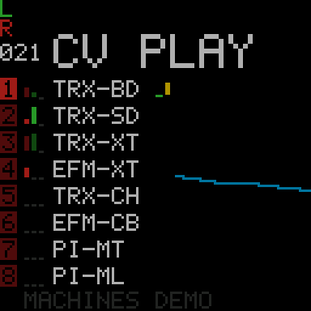 | **HOME**: channels with their voices, CV bars and the scope. |
| 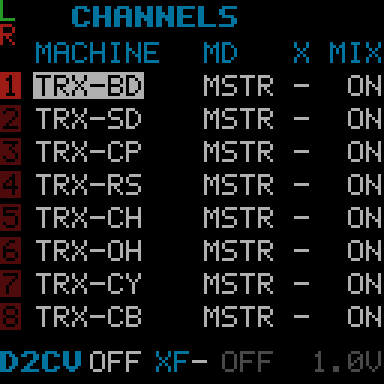 | **CHANNELS**: one voice per channel. |
| 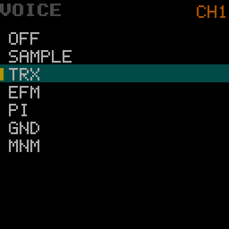 | **VOICE**: sampler or a family (TRX, EFM, PI, GND, MNM). |
| 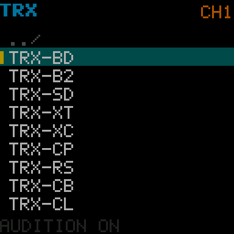 | A family's models. |
| 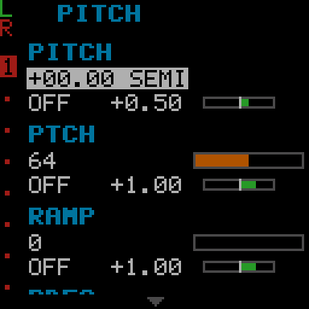 | **PITCH** on a machine, with the voice's own parameters. |
| 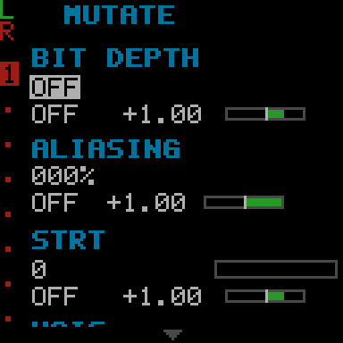 | **MUTATE** on a machine. |
| 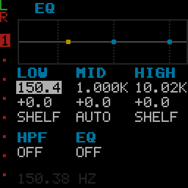 | **EQ**, per channel. |
| 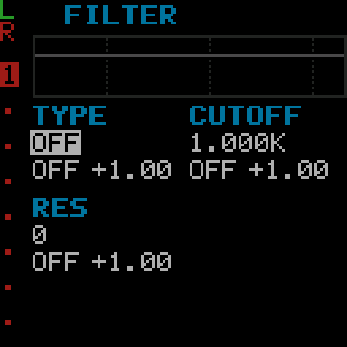 | **FILTER**, per channel. |
| 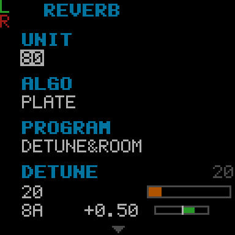 | **REVERB** on unit 80: ALGO, PROGRAM and the program's fields with CV. |
| 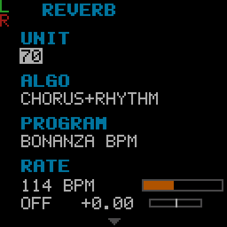 | **REVERB** on unit 70. |
| 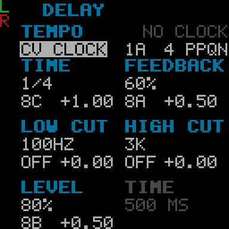 | **DELAY**, with a BPM or CV clock tempo. |
| 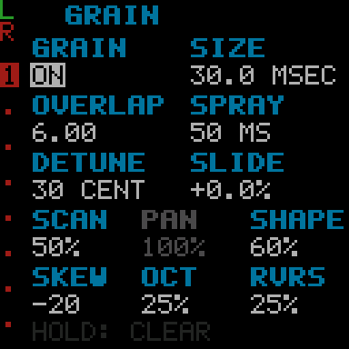 | **GRAIN** on a sampler channel. |
| 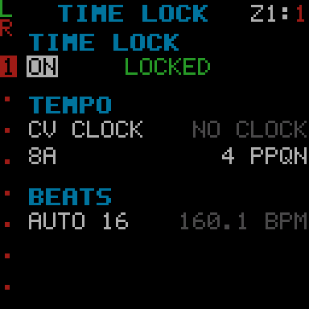 | **TIME LOCK** on a sampler channel. |
| 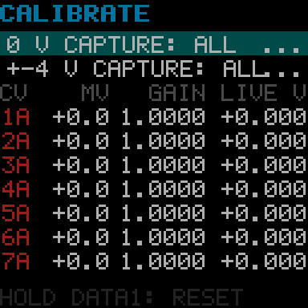 | **CALIBRATE** (UTILITY): the `cal.bin` table with live readings. |
| 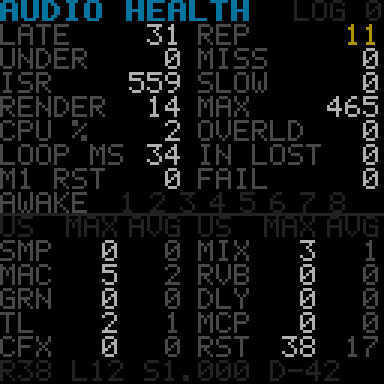 | **AUDIO HEALTH** (UTILITY): CPU use per DSP stage. |

## Pages and buttons

Pages are modal, as on stock. A page button opens its page; pressing it
again steps through that button's pages, and the press after the last one
goes back to the HOME screen.

| Button      | Pages                                   |
|-------------|-----------------------------------------|
| CHANNELS    | CHANNELS → REVERB → DELAY → MIX COMP     |
| PITCH       | PITCH → TIME LOCK                       |
| MUTATE      | MUTATE → EQ → EQ CV                     |
| PHASE MOD   | PHASE MOD → GRAIN → GRAIN CV            |
| ENVELOPE    | ENVELOPE → FILTER                       |
| PAN/MIX     | PAN/MIX → COMP → SENDS                  |
| LEVEL       | LEVEL                                   |
| ZONES       | ZONES (sampler) / MACHINE → MACHINE CV (machine) |
| UTILITY     | UTILITY (its list holds the other pages) |

Gestures that differ from stock: Zone Lock is a 2 s hold of ZONES (stock:
a double-click); importing from another folder is a DATA1 double-click on
the folder on the LOAD page (stock: a LOAD double-click).

A channel's voice is picked in the MACHINE column on CHANNELS or on the
MACHINE page: the family list first (SAMPLE, TRX, EFM, PI, GND, MNM), then
its models. Sample position, loop and recording buttons work as on stock on
sampler channels.

## Differences from stock

- Gestures: see Pages and buttons above (Zone Lock and folder import).
- Gate-to-sound latency is about 1.5 ms (stock about 0.2 ms).

## If something goes wrong

- **Hang recovery:** if the module ever freezes, it restarts by itself
  about 6 seconds later and shows RECOVERED FROM HANG.
- **Crash screens:** a crash report screen stays up until you power-cycle.
- **Health log:** on UTILITY → AUDIO HEALTH, a click of DATA1 writes a line
  to `A8M-HEALTH.JSONL` on the front card; overloads and hang recoveries
  are logged automatically.
- **Reporting:** open a GitHub issue with crash photos and/or health logs.

## Known gaps

- No MIDI (the Locutus link is not supported).
- Stock's card utilities (format card, make boot card, load boot
  software) are missing.

## Building

Needs the GNU Arm Embedded toolchain (`arm-none-eabi-gcc`), `make` and
Python 3.

    make -C fw            # fw/build/app
    make -C fw DEBUG=1    # fw/build-debug/app, with runtime checks

The version lives in `fw/VERSION`. A clean checkout at tag `v<version>`
builds as that version ("A8M 2026.4.0"); anything else adds the commit, e.g.
"A8M 2026.4.0-dev+8799c16". `emu/` holds the QEMU machine used to run the
firmware on a computer.

## Credits and licenses

Our code is MIT (`LICENSE`). Vendored code keeps its own license:

- [mdkit](https://github.com/soejrd/mdkit): the TRX, EFM and PI voices
  (CC0, `fw/mdkit`).
- [OP-XY-MNMD](https://github.com/mmockett/OP-XY-MNMD) and its
  [open-xy](https://github.com/etcetc000/open-xy) headers: the GND and MNM
  voices (MIT, `fw/mnmd`).
- [Assimil8or extended firmware](https://github.com/brandon-tallent/assimil8or-extended-firmware)
  (Tallent Edition) by Brandon Tallent: EQ, filter, mix effects, Grain and
  Time Lock DSP (MIT, `fw/tallent`).
- [FatFs](http://elm-chan.org/fsw/ff/) by ChaN (its BSD-style license,
  `fw/fatfs`).

Assimil8or is a trademark of Rossum Electro-Music. No Rossum code is
included.
